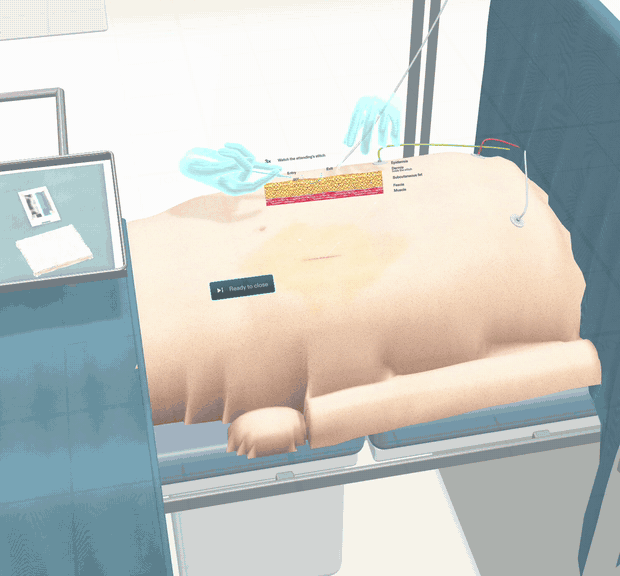
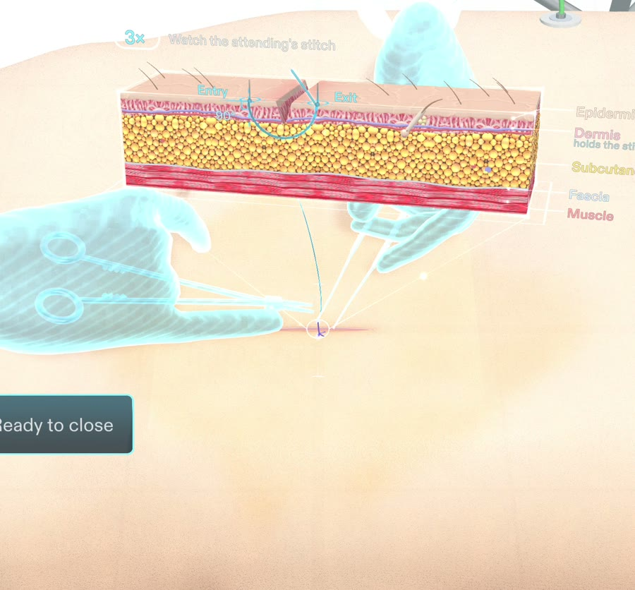
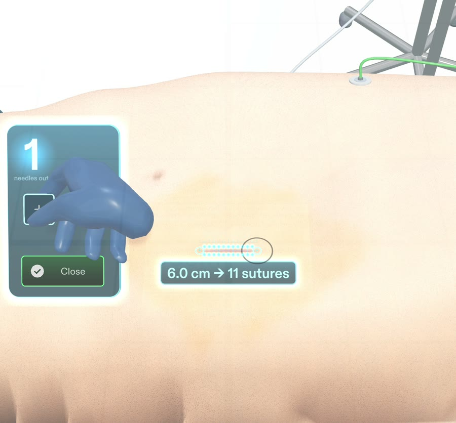
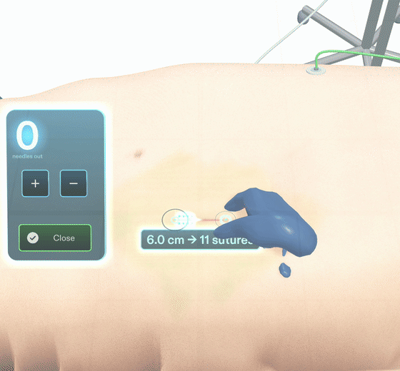
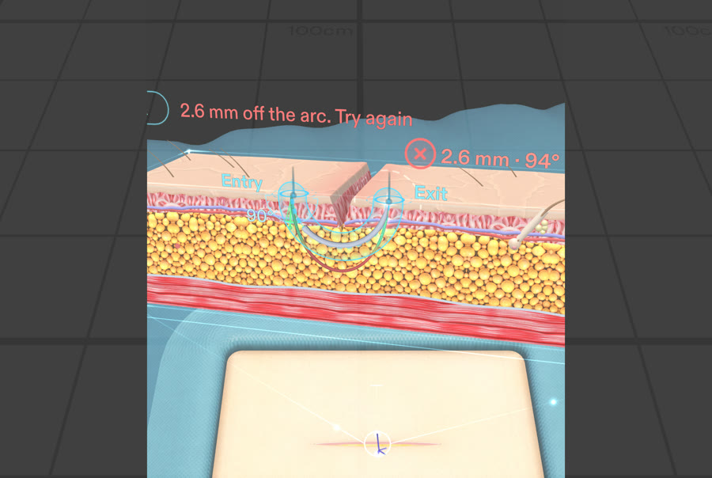
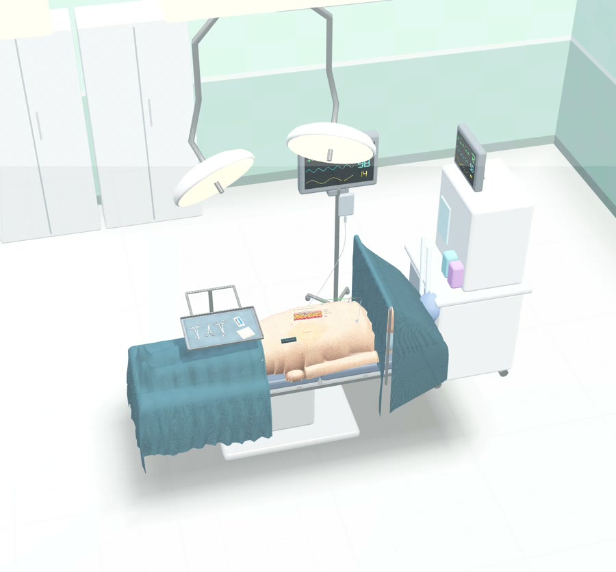
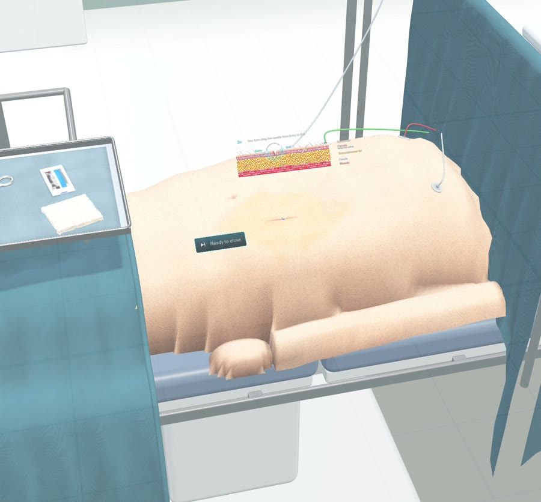
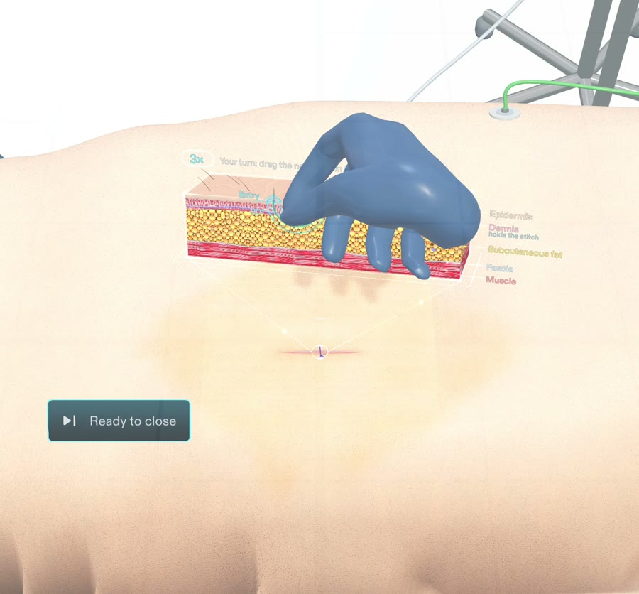
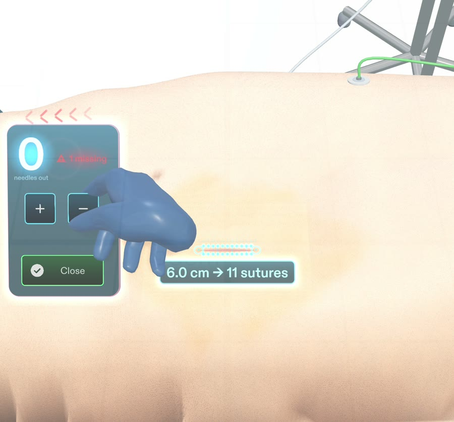
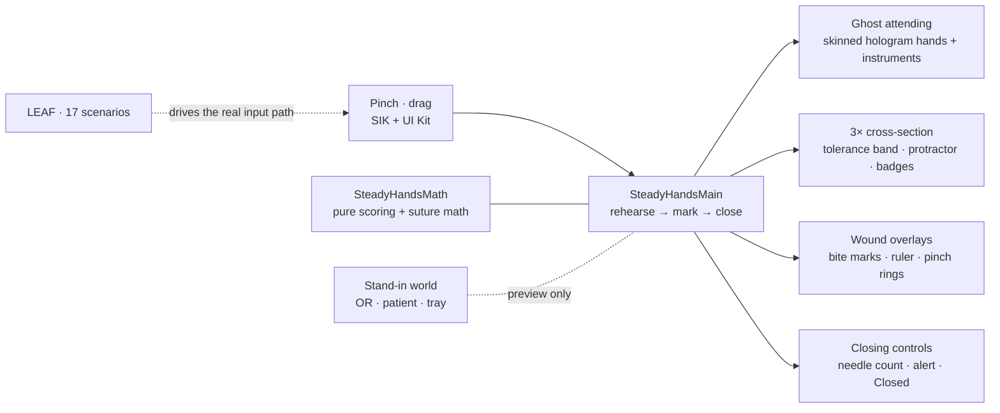

# The Steady Hands

**A ghost attending at your shoulder. Your eyes never leave the wound.**

A hands-free closing companion for surgeons on Snap Specs. A holographic attending demonstrates the stitch, a 3D tissue cutaway grades yours, the wound itself shows where every suture goes, and the field won't close until every needle is back.

**[Watch the 30-second demo](devpost/steady-hands-demo-final.mp4)** · **[Read the design brief](devpost/design-brief.md)**

---

## Why glasses

Once a surgeon scrubs in, **their hands are sterile and their eyes belong to the wound.** They can't touch a phone, a screen or a sheet of paper. Yet a good closure depends on details that are easy to lose: where each bite lands, how deep the needle travels, and whether every needle that came onto the field has gone back to the count.

On a phone or a monitor you would have to look away and couldn't touch anything. On Specs, the guidance lives on the wound itself.

---

## How it works

The flow follows a real closure: **rehearse → mark → close.** One next step at a time, anchored to the wound. There are no dashboards and no menus.

<table>
<tr>
<td width="55%" valign="top">

### 1. Rehearse with the ghost attending
Life-size holographic hands reach in from across the table and place one interrupted stitch: the forceps evert the far edge, the needle enters at 90°, the wrist pronates through the needle's curve, and the thread is pulled through.

Above the wound, a **3× anatomical cutaway** (epidermis, dermis, fat, fascia, muscle) traces the same path from inside the tissue. Then it's your turn: you drag the needle along the arc, through a visible tolerance band.

</td>
<td width="45%" valign="middle"></td>
</tr>
<tr>
<td width="45%" valign="middle"></td>
<td width="55%" valign="top">

### 2. Mark the wound
Pinch both ends of the incision. A millimetre ruler draws itself along the cut, and glowing bite marks cascade into place, 5 mm from each edge and evenly spaced.

A 6.0 cm cut reads **6.0 cm → 11 sutures**. A slightly imperfect pinch still rounds to 11.

</td>
</tr>
<tr>
<td width="55%" valign="top">

### 3. Close, with nothing left behind
Pinch **+** when a needle is opened and **−** when it comes back.

Press *Close* with one still out, and the field answers with a red **"1 missing"**, a low chime, and chevrons pointing back to the instrument tray.

At zero, the sutures light up green one after another, a ring wave rolls across the field, and it reads **Closed**.

</td>
<td width="45%" valign="middle"></td>
</tr>
</table>

**The suture maths.** For a marked length $L$ between the pinched ends $\mathbf{A}$ and $\mathbf{B}$:

$$n = \text{round}\left(\frac{L}{0.5\ \text{cm}}\right) - 1, \qquad \mathbf{x}_i = \mathbf{A} + \frac{i}{n+1}\left(\mathbf{B}-\mathbf{A}\right)$$

---

## Scoring you can see

The practice stitch is judged at **real skin scale**, even though you draw it on the 3× cutaway:

$$d_{\max} \le 1.5\ \text{mm}\ \ (= 4.5\ \text{mm at } 3\times), \qquad \left|\theta_{\text{entry}} - 90^\circ\right| \le 15^\circ$$

- Your thread is coloured segment by segment as you drag: mint inside the band, amber near the edge, coral outside.
- An entry protractor shows your angle against the 90° ± 15° wedge.
- The result is coded by shape as well as colour: a ✓ ring or a ✗ ring.

<table>
<tr>
<td width="50%"></td>
<td width="50%"></td>
</tr>
<tr>
<td align="center"><b>Pass:</b> 0.0 mm off the arc, entry at 90°</td>
<td align="center"><b>Fail:</b> 2.6 mm off the arc. The needle resets for another try.</td>
</tr>
</table>

---

## The operating room

On real glasses, the patient and the room are real, and only the overlays are added. For the preview, we built a full stand-in, procedurally and at real scale:

- an OR with twin surgical lamps, a vitals monitor and an anaesthesia machine;
- a patient on the table under an anaesthesia screen, with the wound prepped on the abdomen;
- a Mayo tray of instruments.

A gloved user hand follows every pinch and drag, so you can see who is working.

<table>
<tr>
<td width="50%"></td>
<td width="50%"></td>
</tr>
<tr>
<td width="50%"></td>
<td width="50%"></td>
</tr>
</table>

---

## Tested end to end

Every done criterion in the [design brief](devpost/design-brief.md) is covered by **LEAF** scenarios. They drive the real Spectacles Interaction Kit input path (pinches, drags, button presses) and read the Lens's state and visuals.

| Done criterion | Scenarios | Result |
| --- | --- | --- |
| On start, the ghost places one stitch and the 3× cross-section shows above it | 1 | Pass |
| Dragging the needle turns the stitch green within 1.5 mm and 15°, red otherwise; green or *Ready to close* ends Rehearse | 8 | Pass |
| Pinching the 6.0 cm cut shows 11 bite marks and "6.0 cm → 11 sutures"; marking 3.0 cm shows 5 | 4 | Pass |
| +, +, −, Close shows the red alert, the chime and "1 missing" | 2 | Pass |
| At zero, Close fades the marks and "Closed" glows green | 2 | Pass |
| **Total** | **17** | **17 / 17, 0 failed assertions** |

---

## How it fits together

- **Logic stays separate from the visuals.** One flow controller exposes readable state. The scoring and suture maths are pure functions. Each visual layer sits behind a stable contract, which let the whole look be rebuilt twice without breaking a test.
- **Ghost attending:**
  - two of SIK's real skinned hand rigs, posed procedurally into a palm grip on a Mayo-Hegar needle driver and a pencil grip on Adson forceps;
  - the wrist motion is solved so the needle tip lands exactly on its entry and exit points;
  - a custom hologram shader: fresnel rim, scan lines, halo, distance fade, and a clip plane so the needle disappears under the skin.
- **Procedural everything.** The OR, the patient, the layered wound, the tissue cutaway and the instruments are generated at runtime with MeshBuilder.
- **Made for the additive display.** On Specs, black is transparent, so the palette is light and the glows are premultiplied. The ghost is a saturated cyan that reads against pale skin.

---

## Quick start

**You need:** [Lens Studio 5.23+](https://ar.snap.com/lens-studio) (the project targets Specs).

1. Clone the repo and open `ghost-attending.esproj` in Lens Studio. It regenerates its cache on first open.
2. In the Preview panel, choose the **SPECS** device and **Interactive** preview.
3. Look down at the table: right-drag to look around, WASD to move, and click to pinch.
   - The ghost demo plays on its own.
   - Then drag the needle from Entry to Exit on the cutaway, or pinch *Ready to close* to skip.
   - Pinch both ends of the incision.
   - Use **+** and **−**, then **Close**.

**Run the tests:** open the LEAF panel and run the `c1` to `c5` scenarios. They're registered by `Assets/Tests/LEAF/LeafIndex.ts`.

> [!TIP]
> Keep Lens Studio as the **front window** while previewing or running tests. In the background, the preview throttles from about 45 fps to about 11 fps.

---

## What's inside

| Folder | What it does |
| --- | --- |
| [`Assets/Scripts/`](Assets/Scripts) | The flow controller (`SteadyHandsMain`), pure scoring and suture maths (`SteadyHandsMath`), and the pad, cross-section, ghost, UI and audio modules |
| [`Assets/Scripts/Visuals/`](Assets/Scripts/Visuals) | Procedural geometry and effects: OR room, patient, wound, tissue cutaway, instruments, hand rig, overlays, user-hand proxy |
| [`Assets/Shaders/Ghost/`](Assets/Shaders/Ghost) | Hologram and halo shaders for the ghost attending |
| [`Assets/Tests/LEAF/`](Assets/Tests/LEAF) | 17 done-criterion scenarios, plus helpers and an aimed interactor for exact pinches and arc drags |
| [`Assets/GeneratedSFX/`](Assets/GeneratedSFX) · [`Assets/GeneratedMeshes/`](Assets/GeneratedMeshes) | Synthesised sound effects and text-to-3D instrument models |
| [`devpost/`](devpost) | Design brief and demo videos |

---

## How it was built

- **Planned with the Devpost Learn skill pack.** The *plan-lens* interview produced an approved [design brief](devpost/design-brief.md). It pins every element to real-world centimetres and defines five testable done criteria.
- **Built with CLAD in Lens Studio, through the Lens Studio MCP.**
  - The first build came from the brief.
  - A full visual rebuild followed, in four focused passes: stage, ghost attending, overlays and cross-section.
  - All of it was held to the same LEAF test contracts.
- **Also used:**
  - Spectacles Interaction Kit and UI Kit;
  - LEAF for automated testing;
  - MeshBuilder, Shader Graph and VFX Graph;
  - Lens Studio text-to-3D for the tray instruments;
  - synthesised audio for every sound cue.

---

## Honest notes

- **It has never run on a real Specs device.** Two things only hardware can answer: whether hand tracking works with gloved hands holding instruments, and whether a mid-air pinch can mark incision ends to the millimetre.
- **The entry and exit defaults and the tolerances need clinical review** before any real use.
- **The patient and the operating room are a preview stand-in.** On device, the real ones take their place.

> *The Steady Hands is a concept demonstrated on a training stand-in. It is not a medical device.*

---

Built by **Gaurav Shrivastava** for **Learn AR with SPECS** on Devpost.

